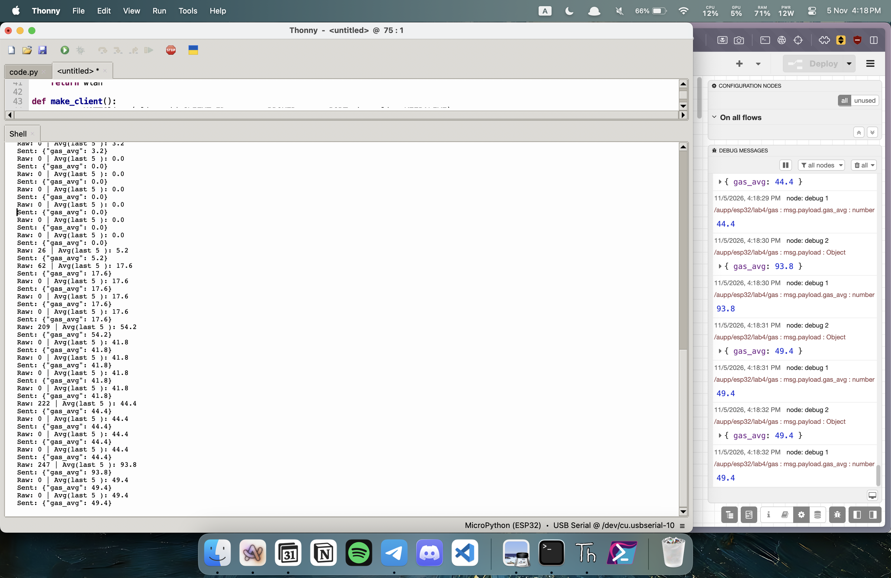
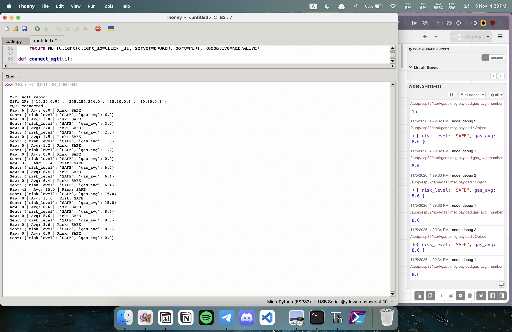
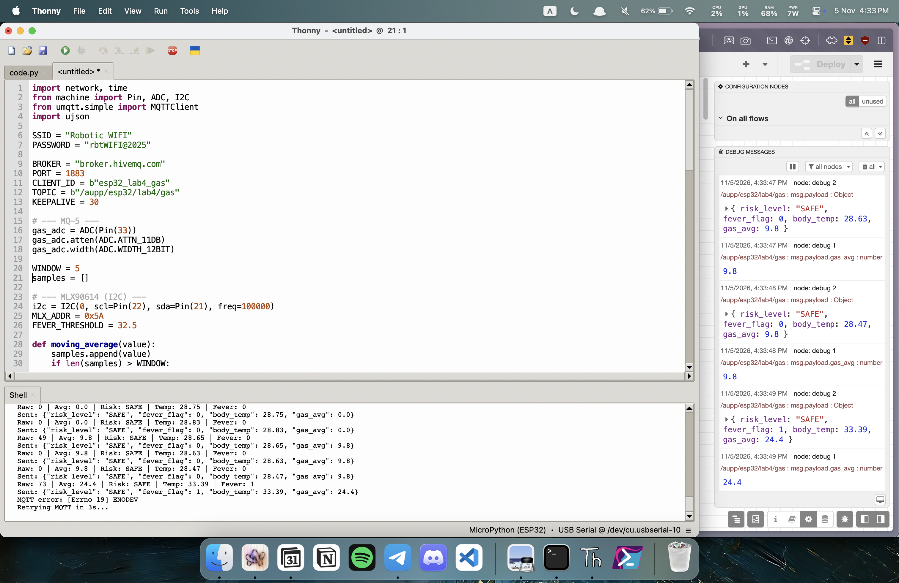
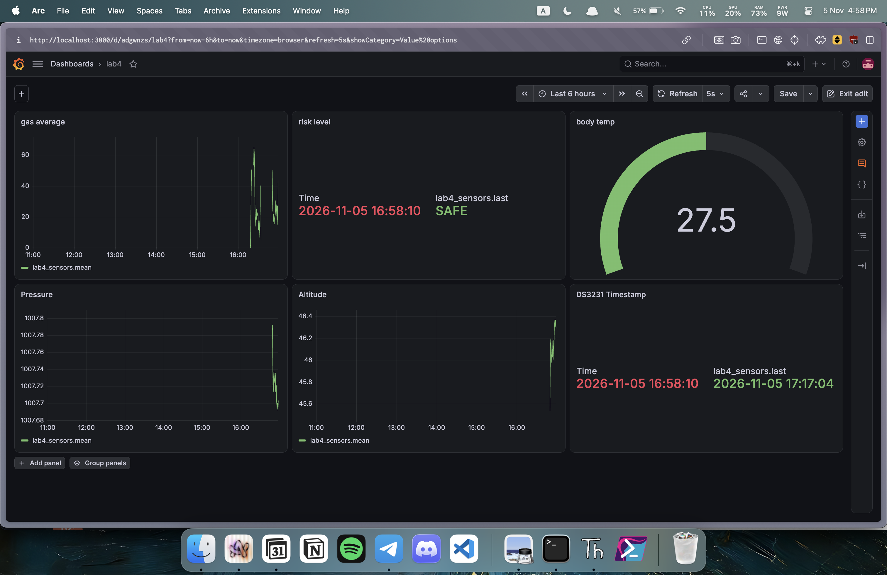

# Lab 4: Multi-Sensor IoT Monitoring with Grafana Dashboard

## Group Members

- Andy Eang

- Ngeabheng Chan

- Sereyvattanac Na


## 1. Overview

In this lab, you will design and implement a multi-sensor IoT monitoring system using an **ESP32** microcontroller running **MicroPython** (via Thonny IDE). The system integrates four hardware sensors:
* **MLX90614**: Non-contact infrared body temperature sensor.
* **MQ-5**: Combustible gas sensor.
* **BMP280**: Barometric pressure, room temperature, and altitude sensor.
* **DS3231**: High-precision Real-Time Clock (RTC) module for timestamping.

Before sending sensor data across the network, the ESP32 performs edge logic processing—including moving average filtering for noisy analog signals, rule-based gas risk classification, and fever threshold detection. Structured JSON packets are transmitted over HTTP to **Node-RED**, stored in an **InfluxDB** time-series database, and visualized on a real-time **Grafana** dashboard.

---

## 2. Learning Outcomes (CLO Alignment)

* Integrate multiple I2C and analog sensors with ESP32.
* Implement moving average filtering for noisy analog sensor signals.
* Create rule-based classification logic at the edge.
* Structure JSON packets for IoT data transmission.
* Store time-series sensor data in InfluxDB via Node-RED.
* Design and configure multi-panel dashboards using Grafana.

---

## 3. Equipment & Hardware Setup

### Component List

* ESP32 Development Board (MicroPython firmware flashed)
* MLX90614 Infrared Body Temperature Sensor (I2C)
* MQ-5 Gas Sensor Module (Analog output)
* BMP280 Barometric Pressure Sensor (I2C)
* DS3231 Real-Time Clock Module (I2C)
* Solderless Breadboard & Male-to-Female / Male-to-Male Jumper Wires
* USB Data Cable & Host PC with Thonny IDE
* Wi-Fi Connection (2.4 GHz)
* PC/Server running Node-RED, InfluxDB, and Grafana

> **Caution:** BMP280, MLX90614, and DS3231 operate at **3.3V**. The MQ-5 sensor requires **5V VCC** for proper heater circuit operation, but its analog signal line (`AOUT`/`A0`) is safe for the ESP32 3.3V ADC logic. Connecting 5V directly to 3.3V sensor supply pins will damage the modules.

---

### Wiring Diagram


### Pin Connections

| Component | Component Pin | ESP32 Pin | Bus / Signal Protocol | Description |
| :--- | :--- | :--- | :--- | :--- |
| **MLX90614** | VCC | 3.3V | — | Power Supply |
| | GND | GND | — | Ground |
| | SDA | GPIO21 | I2C | Shared I2C Data Line |
| | SCL | GPIO22 | I2C | Shared I2C Clock Line |
| **BMP280** | VCC | 3.3V | — | Power Supply |
| | GND | GND | — | Ground |
| | SDA | GPIO21 | I2C | Shared I2C Data Line |
| | SCL | GPIO22 | I2C | Shared I2C Clock Line |
| **DS3231** | VCC | 3.3V | — | Power Supply |
| | GND | GND | — | Ground |
| | SDA | GPIO21 | I2C | Shared I2C Data Line |
| | SCL | GPIO22 | I2C | Shared I2C Clock Line |
| **MQ-5** | VCC | 5V / VIN | — | Power Supply (5V Required) |
| | GND | GND | — | Ground |
| | AOUT / A0 | GPIO33 | Analog (ADC) | 12-bit ADC Input Channel |

---

## 4. System Description & Architecture

### Edge Processing Workflow

1. **Gas Signal Smoothing**: The ESP32 reads 12-bit raw ADC values from the MQ-5 gas sensor and computes a 5-sample moving average to eliminate high-frequency noise.
2. **Gas Risk Classification**: Edge rules map the averaged ADC value to categorical safety states (`SAFE`, `WARNING`, or `DANGER`).
3. **Fever Flag Calculation**: The MLX90614 object temperature is compared against $32.5^\circ\text{C}$ to set a binary `fever_flag` ($0$ or $1$).
4. **Environment & Time Tracking**: Atmospheric pressure (hPa) and altitude (meters) are retrieved from the BMP280, alongside ISO-formatted timestamp data from the DS3231 RTC.
5. **Data Transmission**: A structured JSON payload is posted to Node-RED via HTTP POST, written to InfluxDB, and displayed on Grafana.

---

### JSON Payload Structure

```json
{
  "timestamp": "2026-11-10T15:30:00",
  "gas_raw": 1850,
  "gas_avg": 1870.0,
  "risk_level": "SAFE",
  "body_temp": 36.5,
  "fever_flag": 0,
  "room_temp": 24.5,
  "pressure": 1013.25,
  "altitude": 45.2
}
```

---

### System Architecture & Flowchart


```
┌──────────────────────────────────────────────────────────────┐
│                            ESP32                             │
│  ┌────────────────────────────────────────────────────────┐  │
│  │                  MicroPython Runtime                   │  │
│  │                                                        │  │
│  │  ┌──────────┐  ┌──────────┐  ┌────────┐  ┌────────┐    │  │
│  │  │ MLX90614 │  │  BMP280  │  │  MQ-5  │  │ DS3231 │    │  │
│  │  │  Driver  │  │  Driver  │  │  ADC   │  │ (RTC)  │    │  │
│  │  └────┬─────┘  └────┬─────┘  └───┬────┘  ────┬───┘    │  │
│  │       │             │            │           │        │  │
│  │  ┌────┴─────────────┴────────────┴───────────┴──────┐  │  │
│  │  │              Edge Logic Processing               │  │  │
│  │  │  - Moving Average Filter (MQ-5, window=5)        │  │  │
│  │  │  - Gas Risk Classification (SAFE/WARN/DANGER)    │  │  │
│  │  │  - Fever Detection Logic (Threshold 32.5°C)      │  │  │
│  │  │  - JSON Packet Assembly & Formatting             │  │  │
│  │  └──────────────────────────┬───────────────────────┘  │  │
│  │                             │ HTTP POST                │  │
│  └─────────────────────────────┼──────────────────────────┘  │
└────────────────────────────────┼─────────────────────────────┘
                                 ▼
               ┌───────────────────────────────────┐
               │             Node-RED              │
               │  HTTP In ──► JSON Parse ──► Influx │
               └─────────────────┬─────────────────┘
                                 │
                                 ▼
               ┌───────────────────────────────────┐
               │             InfluxDB              │
               │    Time-Series Storage (iot_lab4) │
               └─────────────────┬─────────────────┘
                                 │
                                 ▼
               ┌───────────────────────────────────┐
               │              Grafana              │
               │     Multi-Panel Monitoring UI     │
               └───────────────────────────────────┘
```

---

## 5. System Configuration & Setup

### ESP32 Configuration (`main.py`)

```python
# Network & Node-RED Parameters
WIFI_SSID = "Robotic WIFI"
WIFI_PASS = "rbtWIFI@2025"
NODE_RED_URL = "http://10.30.0.207:1880/iot/gas"

# Pin Assignments
MQ5_PIN = 33      # ADC Input
I2C_SDA = 21      # Shared I2C Data
I2C_SCL = 22      # Shared I2C Clock

# Threshold Constants
GAS_WINDOW_SIZE = 5
GAS_WARN_THRESH = 2100
GAS_DANG_THRESH = 2600
FEVER_THRESH    = 32.5  # degrees Celsius
```

---

### Step-by-Step Environment Setup

#### 1. Node-RED Flow Configuration
1. Launch Node-RED on your local system or gateway server:
   ```bash
   node-red
   ```
2. Navigate to `http://localhost:1880` in your web browser.
3. Install the InfluxDB palette node: **Menu → Manage palette → Install → search `node-red-contrib-influxdb`**.
4. Build the ingestion pipeline:
   * **HTTP In Node**: Method `POST`, URL endpoint `/iot/gas`.
   * **JSON Node**: Action `Always convert to JavaScript Object`.
   * **InfluxDB Out Node**: Point to target database `iot_lab4`.
5. Click **Deploy**.

#### 2. InfluxDB Setup
1. Start the InfluxDB service engine:
   ```bash
   influxd
   ```
2. Open the Influx CLI shell and instantiate the target database:
   ```sql
   CREATE DATABASE iot_lab4
   ```
3. Confirm Node-RED InfluxDB node connectivity to `localhost:8086`, Database `iot_lab4`, Measurement `sensor_readings`.

#### 3. Grafana UI Dashboard Setup
1. Launch the Grafana dashboard server:
   ```bash
   brew services start grafana
   ```
2. Access `http://localhost:3000` (Default credentials: `admin` / `admin`).
3. Add **InfluxDB** as a Data Source:
   * URL: `http://localhost:8086`
   * Database: `iot_lab4`
   * HTTP Method: `GET` / `POST`
4. Import or build panels mapped to measurement fields.

#### 4. ESP32 Device Deployment
1. Connect ESP32 via USB and open **Thonny IDE**.
2. Upload necessary MicroPython peripheral drivers to the ESP32 filesystem:
   * `mlx90614.py`
   * `bmp280.py`
   * `ds3231.py`
3. Save main application code as `main.py` onto the ESP32 root folder.
4. Run script and inspect output in the Thonny REPL serial panel.

---

## 6. Tasks & Checkpoints

### Task 1 - Gas Filtering (Moving Average)

**Objective**: Interface the MQ-5 gas sensor to ESP32 ADC (12-bit, range 0–4095), implement a 5-sample moving average buffer, output raw and filtered values to serial, and transmit the smoothed value to Node-RED.

#### MicroPython Implementation:

```python
from machine import ADC, Pin

adc = ADC(Pin(33))
adc.atten(ADC.ATTN_11DB)
adc.width(ADC.WIDTH_12BIT)

gas_buffer = []
WINDOW_SIZE = 5

def calculate_moving_average(new_sample):
    gas_buffer.append(new_sample)
    if len(gas_buffer) > WINDOW_SIZE:
        gas_buffer.pop(0)
    return sum(gas_buffer) / len(gas_buffer)

# Execution loop sampling
gas_raw = adc.read()
gas_avg = calculate_moving_average(gas_raw)
print("Raw ADC:", gas_raw, "| Moving Avg:", gas_avg)
```



---

### Task 2 - Gas Risk Classification

**Objective**: Evaluate the moving average gas reading against predefined threshold rules to determine system security level (`SAFE`, `WARNING`, or `DANGER`), sending the `risk_level` field in the payload.

#### Classification Threshold Rules:

| Averaged ADC Value Range | Risk Level State | Description |
| :--- | :--- | :--- |
| **$< 2100$** | `SAFE` | Baseline ambient gas level |
| **$2100 - 2599$** | `WARNING` | Elevated gas presence detected |
| **$\ge 2600$** | `DANGER` | High concentration gas hazard |

#### MicroPython Implementation:

```python
def classify_gas_risk(avg_value):
    if avg_value < 2100:
        return "SAFE"
    elif avg_value < 2600:
        return "WARNING"
    else:
        return "DANGER"

risk_level = classify_gas_risk(gas_avg)
print("Evaluated Risk Level:", risk_level)
```




---

### Task 3 - Fever Detection Logic

**Objective**: Read infrared object temperature from the MLX90614 sensor, evaluate against the fever threshold rule ($\ge 32.5^\circ\text{C}$), and append the binary `fever_flag` indicator to the transmitted packet.

#### Detection Logic Rule:
$$\text{fever\_flag} = \begin{cases} 1 & \text{if } \text{body\_temp} \ge 32.5^\circ\text{C} \\ 0 & \text{otherwise} \end{cases}$$

#### MicroPython Implementation:

```python
from machine import I2C, Pin
import mlx90614

i2c = I2C(0, sda=Pin(21), scl=Pin(22), freq=100000)
mlx = mlx90614.MLX90614(i2c)

FEVER_THRESHOLD = 32.5

def detect_fever(object_temp):
    return 1 if object_temp >= FEVER_THRESHOLD else 0

body_temp = mlx.object_temp()
fever_flag = detect_fever(body_temp)
print("Body Temp:", body_temp, "°C | Fever Flag:", fever_flag)
```



---

### Task 4 - Pressure & Altitude Monitoring (Grafana Integration)

**Objective**: Obtain barometric pressure (hPa) and estimated altitude (meters) from the BMP280 module alongside real-time timestamping from the DS3231 RTC. Stream packet data into InfluxDB and build a comprehensive 6-panel Grafana dashboard.

#### Sensor Acquisition & Payload Transmission Code:

```python
import urequests
import json
import bmp280
import ds3231

bmp = bmp280.BMP280(i2c)
rtc = ds3231.DS3231(i2c)

pressure = bmp.pressure    # hPa
altitude = bmp.altitude    # Meters
dt = rtc.datetime()        # (Year, Month, Day, Weekday, Hour, Min, Sec, Sub-sec)

timestamp = "{:04d}-{:02d}-{:02d}T{:02d}:{:02d}:{:02d}".format(
    dt[0], dt[1], dt[2], dt[4], dt[5], dt[6]
)

payload = {
    "timestamp": timestamp,
    "gas_raw": gas_raw,
    "gas_avg": gas_avg,
    "risk_level": risk_level,
    "body_temp": body_temp,
    "fever_flag": fever_flag,
    "room_temp": bmp.temperature,
    "pressure": pressure,
    "altitude": altitude
}

response = urequests.post(NODE_RED_URL, json=payload)
response.close()
```

---

#### Grafana Dashboard Panel Configuration

| Panel ID | Panel Title | Visualization Type | Target InfluxDB Field | Query Logic / InfluxQL |
| :--- | :--- | :--- | :--- | :--- |
| **1** | Gas Average | Time Series | `gas_avg` | `SELECT mean("gas_avg") FROM "sensor_readings" WHERE $timeFilter GROUP BY time($__interval)` |
| **2** | Gas Risk Level | Stat / Single Stat | `risk_level` | `SELECT last("risk_level") FROM "sensor_readings" WHERE $timeFilter` |
| **3** | Body Temperature | Gauge | `body_temp` | `SELECT last("body_temp") FROM "sensor_readings" WHERE $timeFilter` |
| **4** | Atmospheric Pressure | Time Series | `pressure` | `SELECT mean("pressure") FROM "sensor_readings" WHERE $timeFilter GROUP BY time($__interval)` |
| **5** | Altitude Graph | Time Series | `altitude` | `SELECT mean("altitude") FROM "sensor_readings" WHERE $timeFilter GROUP BY time($__interval)` |
| **6** | Room Temperature | Gauge / Stat | `room_temp` | `SELECT last("room_temp") FROM "sensor_readings" WHERE $timeFilter` |





## 7. Technical Features & Highlights

* **Edge Computation & Filtering**: Reduces noise on analog ADC channels directly on the ESP32 before cloud transmission.
* **Shared I2C Bus Topology**: Runs MLX90614, BMP280, and DS3231 concurrently over GPIO21/GPIO22 via address discrimination.
* **Time-Series Persistence**: Decouples network processing using Node-RED and stores structured readings efficiently in InfluxDB.
* **Fault-Tolerant Network Loop**: Encloses HTTP communications within `try-except` blocks to maintain local microcontroller runtime during transient connectivity dropouts.

---


